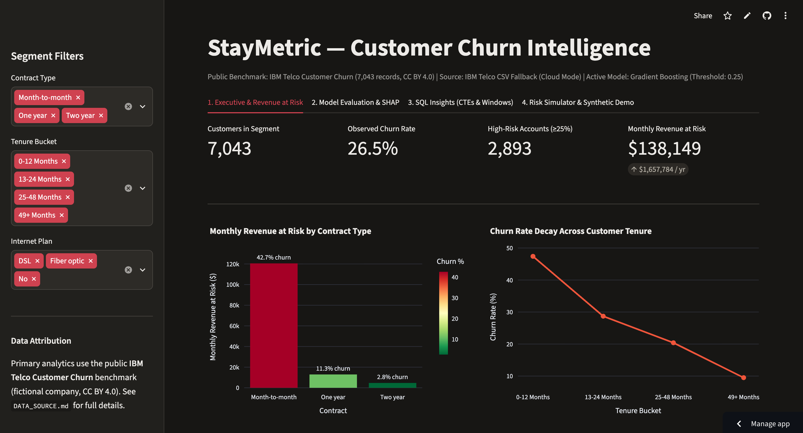

# StayMetric — Customer Churn Intelligence & Prediction Engine

[](https://staymetric.streamlit.app/)
[](https://www.python.org/)
[](sql/analytics_views.sql)
[-2EA44F?style=for-the-badge)](DATA_SOURCE.md)



## Problem Statement
Subscription businesses lose compounding recurring revenue when high-value accounts cancel silently. **StayMetric** is an end-to-end SQL, Machine Learning, and Business Intelligence platform that identifies at-risk subscribers before cancellation, quantifies **Expected Revenue at Risk** (`predicted churn probability × monthly charges`), explains churn drivers via **SHAP**, and estimates the financial ROI of targeted retention campaigns.

> **Data Integrity Note:** All analytics, SQL views, model evaluations, and financial estimates are computed strictly on the **public IBM Telco Customer Churn benchmark dataset** (7,043 rows, fictional telecom company, CC BY 4.0)—not proprietary customer PII. Legacy Faker data is isolated inside `synthetic_demo/` and labeled strictly as synthetic demo data.

---

## Architecture

```text
IBM Telco CSV (7,043 rows, CC BY 4.0)
        │
        ▼  src/load_telco_to_mysql.py (cleans 11 blank TotalCharges rows)
MySQL Relational Database (churn_engine.telco_customers)
        │
        ├──▶ sql/analytics_views.sql (CTEs & Window Functions)
        │       • v_churn_by_tenure
        │       • v_churn_by_payment
        │       • v_churn_by_segment
        │
        └──▶ src/train_pipeline.py (Leakage-Safe ImbPipeline + Stratified 5-Fold CV)
                • Benchmarks 7 models (Baseline, LogReg, RF, SMOTE, Gradient Boosting)
                • Out-of-Fold threshold tuning (0.50 → 0.25) + Global SHAP
                • Exports artifacts/ (best_model.pkl, cv_results.csv, shap_importance.csv)
                        │
                        ▼
             Streamlit & Plotly Dashboard (app.py)
             • Live MySQL connection locally + automatic IBM CSV fallback on Cloud
             • Segment Filters, Revenue at Risk, Retention ROI, A/B Test Design & Simulator
```

---

## Model Evaluation & Threshold Tuning

All preprocessing (`StandardScaler`, `OneHotEncoder`) and resampling (`SMOTE`) are scoped strictly inside `imblearn.pipeline.Pipeline` folds on the 80% training split, with `customer_id` dropped and verified via automated `pytest` leakage checks.

### Stratified 5-Fold Cross-Validation Results (Sorted by PR-AUC)

| Model | PR-AUC | ROC-AUC | F1-Score | Recall | Precision |
| :--- | :---: | :---: | :---: | :---: | :---: |
| **Gradient Boosting (Selected)** | **0.654 ± 0.043** | **0.846 ± 0.017** | 0.586 ± 0.029 | 0.524 ± 0.028 | 0.666 ± 0.042 |
| Random Forest (Balanced) | 0.653 ± 0.046 | 0.841 ± 0.018 | 0.630 ± 0.024 | 0.746 ± 0.033 | 0.545 ± 0.023 |
| Random Forest | 0.653 ± 0.044 | 0.840 ± 0.017 | 0.578 ± 0.032 | 0.514 ± 0.038 | 0.663 ± 0.032 |
| Logistic Regression | 0.652 ± 0.044 | 0.845 ± 0.017 | 0.605 ± 0.026 | 0.557 ± 0.028 | 0.662 ± 0.032 |
| Logistic Regression (Balanced) | 0.651 ± 0.043 | 0.845 ± 0.017 | 0.629 ± 0.013 | 0.804 ± 0.013 | 0.517 ± 0.016 |
| Random Forest + SMOTE | 0.642 ± 0.048 | 0.839 ± 0.017 | 0.627 ± 0.026 | 0.678 ± 0.028 | 0.584 ± 0.026 |
| Majority-Class Baseline | 0.265 ± 0.000 | 0.500 ± 0.000 | 0.000 ± 0.000 | 0.000 ± 0.000 | 0.000 ± 0.000 |

**Model Selection Note:** The top models are statistically comparable across folds—their PR-AUC scores (`0.654`, `0.653`, `0.652`, `0.651`, each `± ~0.043`) fall well within one standard deviation of each other, and Logistic Regression achieves nearly identical ROC-AUC (`0.845` vs. `0.846`). Gradient Boosting was selected as the active pipeline for achieving the highest mean PR-AUC, while Logistic Regression remains a simpler, more directly interpretable alternative with negligible performance trade-off.

### Untouched Holdout Test Set (20% Split — 1,409 Accounts)
* **ROC-AUC:** `0.848` | **PR-AUC:** `0.665`
* **Default Threshold (`0.50`):** Recall `50.8%` | Precision `65.3%` | F1 `0.571` | Accuracy `79.8%`
* **Tuned Threshold (`0.25`):** Recall **`80.2%`** | Precision `52.5%` | F1 **`0.635`** | Accuracy `75.5%`
* **Confusion Matrix (`@ 0.25`):** `TN = 764`, `FP = 271`, `FN = 74`, `TP = 300` (captures 300 of 374 actual churners)

**Why lower the threshold from `0.50` to `0.25`?**
At `0.50`, Gradient Boosting misses nearly half of real churners. Dropping the cutoff to `0.25` (selected via out-of-fold F1 optimization) lifts recall by **+29.4 percentage points**. In subscription retention, sending a low-cost outreach offer to a false positive is far cheaper than losing 12+ months of recurring billing from a missed churner.

---

## Key Findings & Business Impact

* **Top Churn Drivers (Global Mean `|SHAP|`):**
  1. `contract_Month-to-month` (`0.620`) — Month-to-month users churn at **42.7%** vs. **11.3%** (1-year) and **2.8%** (2-year).
  2. `tenure` (`0.415`) — Risk concentrates heavily in the first 12 months before decaying steadily.
  3. `tech_support_No` (`0.231`) — Accounts lacking tech support experience sharply higher friction.
  4. `internet_service_Fiber optic` (`0.199`) & `monthly_charges` (`0.194`) — High-ARPU Fiber plans carry disproportionate revenue exposure.
* **Portfolio Revenue Exposure:** Across the 7,043-account benchmark (**26.5%** churn), **2,893 accounts** cross the `0.25` risk threshold, representing **$138,149/month ($1.66M/year)** in expected revenue at risk. These portfolio-level figures are computed by scoring all 7,043 rows with the serialized Gradient Boosting model trained on the 80% training split (rather than out-of-fold predictions), so 80% of the underlying account scores are in-sample.
* **Estimated Retention Impact:**
  * **Annual Contract Upgrade Offer:** Converting **10%** of Month-to-Month subscribers toward 1-Year retention rates saves **~$97,072/year**.
  * **Auto-Pay Migration Nudge:** Migrating **15%** of Electronic Check payers toward automatic payment baselines saves **~$95,126/year**.
* **Experiment Design:** Includes an integrated 50/50 randomized A/B test specification (two-proportion z-test, α = 0.05, 80% power, 5pp MDE) inside Tab 1 of the dashboard.

### Assumptions & Limitations
* **Causal Assumption in Savings Estimates:** The projected savings (**~$97,072/year** for the contract upgrade offer and **~$95,126/year** for the auto-pay nudge) assume that converted customers will churn at the same rate as existing customers on those plans. Because observational differences may reflect self-selection rather than a causal effect, the A/B test designed in Tab 1 is required to validate actual lift.
* **Illustrative Benchmark Data:** All metrics are derived from a public benchmark dataset representing a fictional telecom company, making the results illustrative rather than production-ready.
* **Static Cross-Sectional Features:** The dataset is a single-point snapshot without longitudinal behavioral signals (such as usage drop-offs, billing disputes, or support ticket velocity), which would be needed for real-time production alerting.

---

## SQL Analytical Depth (`sql/analytics_views.sql`)
Core segmentation metrics live directly inside MySQL views built with **`WITH` CTEs** and **window functions** (`SUM() OVER()`, `RANK() OVER()`, `DENSE_RANK() OVER()`):
* `v_churn_by_tenure` — Lifecycle churn rates, monthly revenue lost, `% of all churners`, and risk rank.
* `v_churn_by_payment` — Compares each payment channel directly against the company-wide churn average.
* `v_churn_by_segment` — Multi-dimensional cohort ranking across `contract × tenure_bucket × internet_service`.

---

## Repository Structure

```text
├── app.py                     # 4-tab Streamlit & Plotly dashboard (root entry for Streamlit Cloud)
├── DATA_SOURCE.md             # Public IBM dataset attribution (CC BY 4.0) & synthetic boundary
├── LICENSE                    # MIT License (code); IBM dataset remains under CC BY 4.0
├── .env.example               # Template for local MySQL credentials (.env is gitignored)
├── requirements.txt           # Pinned runtime dependencies
├── data/
│   └── telco_churn.csv        # Public IBM Telco Customer Churn dataset (7,043 rows)
├── sql/
│   └── analytics_views.sql    # MySQL CTE & window-function analytical views
├── src/
│   ├── load_telco_to_mysql.py # Data cleaning & MySQL ingestion script
│   ├── apply_sql_views.py     # Applies analytical views to MySQL
│   └── train_pipeline.py      # Leakage-safe CV benchmark, threshold tuning & SHAP pipeline
├── artifacts/                 # Serialized best_model.pkl, CV tables, thresholds & SHAP CSVs
├── tests/
│   └── test_pipeline.py       # Automated pytest checks (data integrity, leakage, predictions)
└── synthetic_demo/            # Archived Faker scripts & CSV (labeled synthetic demo only)
```

---

## Local Setup & Testing

1. **Clone & install dependencies:**
   ```bash
   git clone https://github.com/mishitaverma/customer-churn-prediction-engine.git
   cd customer-churn-prediction-engine
   python3 -m venv venv
   source venv/bin/activate
   pip install -r requirements.txt
   ```
2. **Configure MySQL credentials:**
   Create a database named `churn_engine`, copy `.env.example` to `.env`, and add your local MySQL credentials:
   ```bash
   cp .env.example .env
   ```
3. **Run the end-to-end pipeline:**
   ```bash
   python src/load_telco_to_mysql.py
   python src/apply_sql_views.py
   python src/train_pipeline.py
   ```
4. **Run automated tests:**
   ```bash
   pytest -v
   ```
5. **Launch the dashboard:**
   ```bash
   streamlit run app.py
   ```

---

## License
This project's code is licensed under the **MIT License** — see the [LICENSE](LICENSE) file for details. The IBM Telco Customer Churn dataset remains subject to its original **CC BY 4.0** license (see [DATA_SOURCE.md](DATA_SOURCE.md)).
