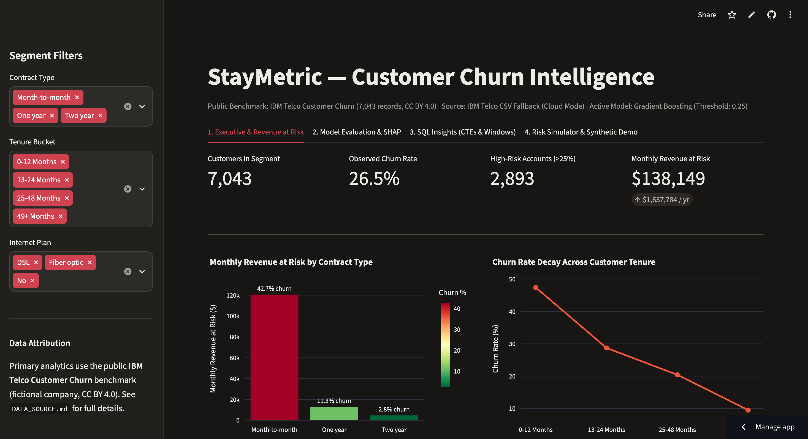

# StayMetric — Customer Churn Intelligence & Prediction Engine

**[Live Dashboard](https://staymetric.streamlit.app/)** | **[Data Attribution (`DATA_SOURCE.md`)](DATA_SOURCE.md)**



## Problem Statement
Subscription businesses lose compounding recurring revenue when high-value accounts cancel silently. **StayMetric** is an end-to-end SQL, Machine Learning, and Business Intelligence platform that identifies at-risk subscribers before cancellation, quantifies **Expected Revenue at Risk** (`predicted churn probability × monthly charges`), explains individual churn drivers via **SHAP**, and estimates the ROI of targeted retention interventions.

> **Data Integrity Note:** All analytics, SQL views, model evaluations, and financial estimates are computed strictly on the **public IBM Telco Customer Churn benchmark dataset** (7,043 rows, fictional telecom company, CC BY 4.0)—not proprietary customer PII. Legacy Faker data is isolated inside `synthetic_demo/` and labeled strictly as synthetic demo data.

---

## Architecture

```text
IBM Telco CSV (7,043 rows, CC BY 4.0)
        │
        ▼  src/load_telco_to_mysql.py (cleans 11 blank TotalCharges rows)
MySQL Relational Database (churn_engine.telco_customers)
        │
        ├──▶ sql/analytics_views.sql (CTEs & Window Functions)
        │       • v_churn_by_tenure
        │       • v_churn_by_payment
        │       • v_churn_by_segment
        │
        └──▶ src/train_pipeline.py (Leakage-Safe ImbPipeline + Stratified 5-Fold CV)
                • Benchmarks 7 models (Baseline, LogReg, RF, SMOTE, Gradient Boosting)
                • Out-of-Fold threshold tuning (0.50 → 0.25) + Global SHAP
                • Exports artifacts/ (best_model.pkl, cv_results.csv, shap_importance.csv)
                        │
                        ▼
             Streamlit & Plotly Dashboard (app.py)
             • Live MySQL connection locally + automatic IBM CSV fallback on Cloud
             • Segment Filters, Revenue at Risk, Retention ROI, A/B Test Design & Simulator