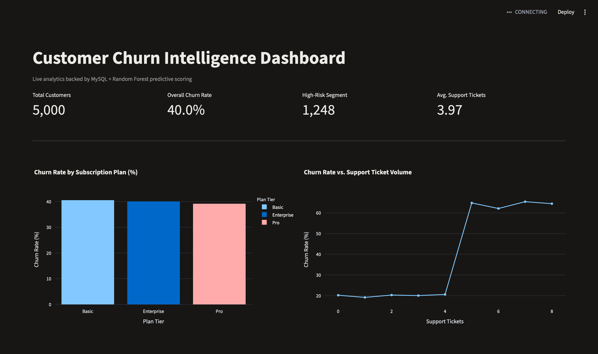

# Customer Churn Intelligence & Prediction Engine


An end-to-end data analytics and machine learning pipeline that generates synthetic SaaS customer behavioral data, stores it in a relational MySQL database, trains a Random Forest classifier, and serves live churn risk predictions through an interactive Streamlit dashboard.

## Architecture
1. **Data Generation (`generate_data.py`):** Simulates 5,000 subscription records (`Faker`) with plan tiers, support ticket counts, inactivity windows, and churn outcomes, then ingests them into MySQL.
2. **ML Training Pipeline (`train_model.py`):** Queries live records directly from MySQL into `pandas`, applies one-hot encoding, trains a `RandomForestClassifier`, and exports the model (`churn_model.pkl`) and feature schema (`model_columns.pkl`).
3. **Interactive Dashboard (`app.py`):** Connects to MySQL to display executive KPIs, churn segmentation charts (`Plotly`), and a real-time churn probability simulator (`Streamlit`).

## Model Performance
* **Accuracy:** 80.00%
* **Churn Class (1) Precision:** 0.80
* **Churn Class (1) Recall:** 0.67
* **Churn Class (1) F1-Score:** 0.73

## Tech Stack
Python | MySQL | Pandas | Scikit-Learn | Streamlit | Plotly | python-dotenv

## Local Setup
1. Clone the repository and create a virtual environment:
   ```bash
   python3 -m venv venv
   source venv/bin/activate
   pip install -r requirements.txt
   ```
2. Create a MySQL database named `churn_engine`.
3. Create a `.env` file in the project root:
   ```env
   DB_HOST=localhost
   DB_USER=root
   DB_PASSWORD=your_mysql_password
   DB_NAME=churn_engine
   ```
4. Run the pipeline:
   ```bash
   python generate_data.py
   python train_model.py
   streamlit run app.py
   ```